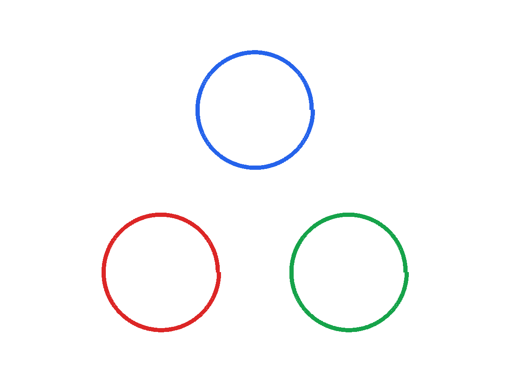

# IVSolver
IPTVisual solver implemented in C++. A fast winding modeler and inductance calculator for arbitrary air-core windings. Used with parametric optimisation programmes in MATLAB, Python, etc..

## Features

- Efficient C++ implementation for high-performance calculations
- Supports modeling of arbitrary air-core winding geometries
- Calculates self and mutual inductance for complex coil arrangements
- Command-line interface for batch processing and integration with scripts
- Designed for use with optimization workflows in MATLAB, Python, and other environments
- Modular code structure for easy extension and customization
- Includes example usage and test cases in the `/examples` directory

See the [wire-forming directive gallery](examples/directives/README.md) for a rendered, runnable use case for each geometry directive.

## Installation
1. Clone the repository:
   ```bash
   git clone git@github.com:guszhang/ivsolver
   cd ivsolver
   ```

2. Build the project:
   on Linux:
   ```bash
   make
   ```

   on Windows:
   Use the provided Visual Studio solution file to build the project.

3. Test the installation:
   Run the example scripts in the `/examples` directory to verify that the solver works correctly.

## Usage
The solver takes text input files of definitions of wires. It has two modes of operation:

### **Impedance Calculation**: Computes the self and mutual inductance of the defined wires.

usage example:
   ```bash
   ivsolver wire_def output_file
   ```

   where `wire_def` contains the definitions of the wires and `output_file` will contain the calculated inductance values.

   The input file format is as follows:
   - First line: number of wires `n` (a positive integer). The next `n` sections define each wire.
   - First line of each wire section: `cs_radius` (wire cross-section radius in metres, as a positive float), followed by `m` (the number of commands, a positive integer). The radius uses the same units as the coordinates; the code does not convert units.
   - First line of each command section: `command_directive`. One of the following chars:
      - `l`: linear segment, followed by `k` number of points (a positive integer number), and then `k` lines of coordinates in the format `x y z` (three float numbers). It connects all key points with lines. It will automatically connect the previous last point (if exist) to the first point in this list.
      - `s`: spiral segment, followed by `k` number of points (a positive integer number), and then `k` lines of coordinates in the format `x y z` (three float numbers). It connects all key points with linearly interpolated spiral arcs along the z-axis. It will automatically connect the previous last point (if exist) to the first point in this list. 
      - `a`: arc segment around an arbitrary vertical axis, followed by `x_z y_z` (two float numbers giving the x and y coordinates of the rotating z-axis), `d` (the direction of the arc, `1` for the positive/increasing-angle direction, which is the same growth direction as in the `s` directive, or `-1` for the negative direction), and `k` number of points (a positive integer number). The next `k` lines are coordinates in the format `x y z` (three float numbers). It connects all key points with linearly interpolated spiral arcs around the axis at `(x_z, y_z)`, interpolating the radius from that axis, the angle around it, and the z-coordinate. It will automatically connect the previous last point (if exist) to the first point in this list. This is the general form of the `s` directive with the axis of rotation freed from the origin, and is useful for making a spiral connection between two line segments without having to move the whole pattern. If a key point has the same angle around the axis as the previous point, a full turn is generated, as in the `s` directive.
      - `g`: saggy segment with known parameter `a`, followed by `k` (a positive integer number of points) and `a` (the sagging parameter). The next `k` lines are coordinates in the format `x y z`. Segments follow the catenary profile $z=a\cosh(\frac{r-r_0}{a})+z_0$, where `r` is radial distance in the x-y plane; the solver determines offsets from the segment endpoints. It connects the previous endpoint to the first listed point when needed. See the [catenary line documentation](./docs/catenary_lines.md).
      - `c`: saggy segment with known length, followed by `k` number of points (a positive integer number). The next `k` lines are coordinates and length of wire in the format `x y z l` (three float numbers and one float number for length). It connects all key points with saggy arcs along the z-axis, where the sagging is determined by the length of the wire segment. It will automatically connect the previous last point (if exist) to the first point in this list. Please see the [saggy segment documentation](./docs/catenary_lines.md).
      - `e`: elliptic arc, followed by `center_x center_y center_z normal_x normal_y normal_z xdir_x xdir_y xdir_z major_radius minor_radius start_angle end_angle`. The axis parameters are semi-axis radii in metres; angles are in degrees. The x direction is projected into the plane, and the positive y direction is `normal × x_direction`. The arc is sampled in the given angle order, with a straight connection from any previous trajectory point to the arc start.
      - `p`: parabolic curve, followed by `origin_x origin_y origin_z normal_x normal_y normal_z xdir_x xdir_y xdir_z a b c x1 x2`. In plane-local coordinates the curve is `y = a*x^2 + b*x + c`, sampled from `x1` to `x2` in metres. The positive y direction is `normal × x_direction`; any previous trajectory point is connected to the curve start by a straight segment.
      - `x`: followed by `angle` (in degrees), which rotates the current wire points generated so far around the x-axis.
      - `y`: followed by `angle` (in degrees), which rotates the current wire points generated so far around the y-axis.
      - `z`: followed by `angle` (in degrees), which rotates the current wire points generated so far around the z-axis.
      - `o`: followed by `x y z`, which translates the current wire points generated so far by that vector.
      - `n`: followed by `x y z`, which rotates the current wire points generated so far so the original positive z direction aligns with the specified vector.
      - `b`: followed by bending radius `r` in metres, which bends the current wire points generated so far around the x-axis to fit a cylindrical surface.
      - `i`: followed by `real imaginary` (two float numbers), which sets the wire's current to the specified complex value. This is used for magnetic field calculations.
  
   All coordinates, wire radii, and lengths are in metres; angles are in degrees. The wires are defined in a 3D Cartesian coordinate system.
   
   In inductance mode, the solver generates `n+1` output files using the designated output path as a prefix. The `.lmat` file contains the `n` by `n` inductance matrix in henries; its final line contains each wire's total length in metres. The `_x.trj` files (`x` from 0 to `n-1`) contain trajectory points as `x y z` coordinates.

   The computation of the inductance matrix is based on the Neumann's formula, which is a well-known method for calculating the self and mutual inductance of wire configurations. The wire generation programme segments the wires into small segments of length equal to the wire diameter, and the inductance is calculated using the following formula given by Maxwell:
   
   $$
   L_{ij} = \frac{\mu_0}{4\pi} \int_{l_i} \int_{l_j} \frac{\mathrm{d}\mathbf{l}_i \cdot \mathrm{d}\mathbf{l}_j}{|\mathbf{r}_i - \mathbf{r}_j|}
   $$
   
   For self-inductance calculation where $\mathrm{d}\mathbf{l}_i$ and $\mathrm{d}\mathbf{l}_j$ refer to the same segment, a closed-form kernel equation is used to avoid divide-by-zero.
   
   $$
   \mathrm{d}L = \frac{\mu_0}{2\pi} \left( l\ln{\left(\frac{l + \sqrt{l^2 + a^2}}{a}\right)}  - \sqrt{l^2 + a^2} + \frac{l}{4} +a  \right)
   $$
   
   where $l$ is the length of the segment, $a$ is the radius of the wire, and $\mu_0$ is the permeability of free space. The solver uses numerical integration to compute the contributions from each segment of the wires.

   The accuracy of this method was verified against the analytical solutions for simple geometries and ANSYS simulations, reported in the appendix of the [IPTVisual paper](https://doi.org/10.3390/wevj13040063).

### **Field Calculation**: Computes the magnetic field at specified observation points.
   usage example:
   ```bash
   ivsolver wire_def output_file -b observation_def
   ```

   where `wire_def` contains the definitions of the wires, `output_file` will contain the calculated magnetic field values, and `observation_def` contains the definition of coordinates of the observation points.

   The input file format is the same to the impedance calculation. Notice that a current must be defined for each wire using the `i` command. The observation points are defined in a separate `observation_def` file, which has the following format:
   - First line: `x_min x_max x_n` (two float numbers and one positive integer number), which defines the range of x-coordinates and the number of points in that range, both inclusive.
   - Second line: `y_min y_max y_n` (two float numbers and one positive integer number), which defines the range of y-coordinates and the number of points in that range, both inclusive.
   - Third line: `z_min z_max z_n` (two float numbers and one positive integer number), which defines the range of z-coordinates and the number of points in that range, both inclusive.
  
   The solver writes `output_file.obs` and one `output_file_x.trj` trajectory file per wire. Each observation row contains nine values: `x y z Bx_real Bx_imag By_real By_imag Bz_real Bz_imag`. Field components are in teslas, with real and imaginary parts listed separately.

   **Complex Current and Field**: The solver supports complex currents and fields for single frequency ac analysis, so that currents of different phases can be defined. The calculation is based on the Biot-Savart law, which states that the magnetic field at a point in space is proportional to the current flowing through a wire and inversely proportional to the distance from the wire to the point.
   
   $$
   \mathbf{B}(\mathbf{r}) = \frac{\mu_0}{4\pi} \int_{l} \frac{I(\mathbf{r'}) \mathrm{d}\mathbf{l'}}{|\mathbf{r} - \mathbf{r'}|^3} \times (\mathbf{r} - \mathbf{r'})
   $$
   
   where $\mathbf{B}(\mathbf{r})$ is the magnetic field at point $\mathbf{r}$, $I(\mathbf{r'})$ is the current at point $\mathbf{r'}$, and $\mathrm{d}\mathbf{l'}$ is the differential length element along the wire. The solver uses numerical integration to compute the contributions from each segment of the wires.

## Contributing
Contributions are welcome! Please submit a pull request or open an issue to discuss changes or improvements. Please contact me if you have any questions or suggestions.

## MCP Coil Design Service

The optional `ivsolver-coil-agent` service exposes a coil design tool over MCP. It generates a three-lobe planar coil system, evaluates candidates with the existing `ivsolver`, and returns an inductance matrix, DC resistance estimates, an L/R score, a fabrication description, the solver wire definition, and a PNG preview.

The current implementation supports **three identical outward-growing spiral coils in one plane**, with their centres 120° apart. It searches inner radius, turn pitch, and lobe-centre radius using a bounded grid search with local refinement. It is a starter topology for design exploration, not a general CAD optimizer or manufacturing sign-off tool. It rejects candidates whose outer bounding circles overlap, but does not yet check thermal limits, AC losses, detailed conductor clearance, or manufacturability.

### Build the separate MCP binary

The MCP build is separate from the original `Makefile` and does not replace `build/ivsolver`.

```bash
python3 -m venv .venv-agent
source .venv-agent/bin/activate
python3 -m pip install -r requirements-agent.txt
make -f Makefile.agent
```

The standalone MCP executable is `dist/ivsolver-coil-agent`. The build also creates `build/ivsolver-agent-backend`, which the MCP service invokes to calculate inductance and wire lengths. Keep both available together when running from the source checkout; the packaged executable includes its backend.

### Use with a local MCP client

The server uses MCP stdio. A local MCP client that can launch stdio servers can start it with this command:

```json
{
  "mcpServers": {
    "ivsolver-coil-design": {
      "command": "/absolute/path/to/ivsolver/dist/ivsolver-coil-agent",
      "args": []
    }
  }
}
```

MCP client configuration files differ; use the client’s documented stdio-server format. The service exposes two tools:

- `design_requirements` lists the physical and geometric inputs needed for a design.
- `design_coil` runs the bounded optimizer and returns the result and PNG image content.

The agent should ask for missing values. If the user explicitly asks it to choose reasonable assumptions, it can do that and report the selected values from the result’s `constraints` object. `design_coil` requires wire cross-section radius, conductor resistivity, geometry search bounds, target-inductance tolerance, and mutual-inductance tolerance. Turn count defaults to three.

### Connect to ChatGPT

ChatGPT does not connect directly to a local stdio process. For a private local setup, use OpenAI Secure MCP Tunnel to bridge the process; this avoids exposing the MCP server to the public internet. Follow the [Secure MCP Tunnel guide](https://developers.openai.com/api/docs/guides/secure-mcp-tunnels) to install `tunnel-client`, create a tunnel in Platform, and set a runtime API key in your local environment. Then configure a local stdio profile:

```bash
tunnel-client init \
  --sample sample_mcp_stdio_local \
  --profile ivsolver \
  --tunnel-id <your-tunnel-id> \
  --mcp-command "/absolute/path/to/ivsolver/dist/ivsolver-coil-agent"

tunnel-client doctor --profile ivsolver --explain
tunnel-client run --profile ivsolver
```

Keep `tunnel-client run` running while ChatGPT discovers or calls the tools. In ChatGPT on the web, add a custom MCP server, select **Tunnel** as the connection, select the tunnel, and create the app. In a new chat, select or `@`-mention the app and describe the design. Current ChatGPT custom MCP access is for Business and Enterprise/Edu workspaces on the web, subject to workspace permissions; Pro custom MCP access is limited to read/fetch tools. See [OpenAI’s ChatGPT connection guide](https://help.openai.com/en/articles/12584461-connecting-custom-mcp-servers-in-chatgpt).

The tool returns a PNG image block. MCP clients that render image content can show it inline; display depends on the client.

### Call it from an LLM application

An application built with an LLM that supports MCP can connect to the local stdio process using its MCP client library. If you use the OpenAI Responses API, the same local process can be reached through Secure MCP Tunnel by passing the tunnel ID to the API’s MCP tool; see the [Responses API MCP guide](https://developers.openai.com/api/docs/guides/tools-connectors-mcp). Responses API model usage is billed under the applicable API pricing.

Minimal Python example for the Responses API, after the tunnel is running:

```python
from openai import OpenAI

client = OpenAI()  # reads OPENAI_API_KEY from the environment
response = client.responses.create(
    model="<model-that-supports-mcp>",
    tools=[
        {
            "type": "mcp",
            "server_label": "ivsolver-coil-design",
            "tunnel_id": "<your-tunnel-id>",
            "allowed_tools": ["design_requirements", "design_coil"],
        }
    ],
    input=(
        "Use the ivsolver coil design tool. Make three identical outward-growing coils, "
        "three turns each, targeting 10 uH self-inductance and at most 100 nH mutual "
        "inductance. Ask me for missing physical inputs."
    ),
)
print(response.output_text)
```

The Responses API MCP tool can require approval before calling tools; keep approval enabled until you trust the workflow. OpenAI documents MCP API billing as model-token usage, with no additional per-MCP-tool-call fee; check the current [API pricing](https://developers.openai.com/api/docs/pricing) for the selected model.

For a public service used by other people, this binary is not yet a public HTTP server: it speaks stdio. You would need to add Streamable HTTP or another supported remote MCP transport and host it at a stable HTTPS endpoint. Secure MCP Tunnel is for private access, not public plugin distribution.

### Example prompts

**Three-lobe flower, target inductance and low coupling**

> Design three identical outward-growing coils in the same flat plane, arranged at 120 degrees like a three-lobe flower. Use three turns per coil and target 10 µH self-inductance per coil. Keep each mutual inductance within 100 nH of zero and maximize self-inductance divided by DC resistance. Use copper with resistivity 1.68×10⁻⁸ Ω·m and wire cross-section radius 1 mm. Search inner radius from 100 to 180 mm, turn pitch from 4 to 10 mm, and lobe-centre radius from 250 to 450 mm. Allow up to 1 µH self-inductance error and a 660 mm maximum footprint radius. Return the rendering, matrix, build description, and solver wire definition.

The example below was calculated using those explicit assumptions. It met the stated tolerances, but its chosen 180 mm inner radius is at the upper bound of the search range. Matrix values are in µH.



| Result | Value |
|---|---:|
| Turns per coil | 3 |
| Wire cross-section radius | 1 mm |
| Inner radius / turn pitch | 180 mm / 4 mm |
| Outer radius | 192 mm |
| Lobe-centre radius | 350 mm |
| Self-inductance per coil | 9.07446 µH |
| Maximum absolute mutual inductance | 62.254 nH |
| Wire length per coil | 3.50602 m |
| DC resistance per coil | 18.75 mΩ |
| L/R per coil | 4.84×10⁻⁴ s |

```text
Inductance matrix (µH)
 9.07446   -0.0603204  -0.0622540
-0.0603204  9.07446   -0.0613072
-0.0622540 -0.0613072  9.07446
```

This three-coil arrangement has an overall diameter of about 1.08 m. The result shows why a footprint constraint matters: the optimizer used widely spaced lobes to keep mutual coupling within tolerance.

The [generated solver wire definition](docs/coil_agent_example_wire_def.txt) and [SVG rendering](docs/coil_agent_example.svg) are included with the PNG preview.

For more winding scenarios, see the [wireless power examples](examples/wireless_power/README.md): a three-coil flower pad through MCP, a hexagonal transmitter/receiver pair, and a bowl-shaped transmitter evaluated against a flat reference under receiver misalignment. The hexagon and bowl examples use the base solver directly; the current MCP design tool supports the flower topology only.

**Ask before making assumptions**

> Design a three-lobe flower coil with three turns and 10 µH per coil. Ask me for any missing conductor, wire-size, footprint, or tolerance inputs before choosing dimensions.

The agent can call `design_requirements` first and ask for missing values. It should not present a design as meeting the target unless the returned `feasible` field is `true`.

**Choose assumptions and disclose them**

> Create a first-pass three-lobe, three-coil design targeting 10 µH per coil. Choose practical defaults for the conductor and geometry bounds, then list every assumption and tolerance used with the result.

The returned `constraints` object records the selected dimensions, resistivity, tolerances, and search settings so the agent can report them.

See [docs/coil_agent.md](docs/coil_agent.md) for implementation details and current limitations. The original solver usage remains unchanged.

**Author:** Gus Cheng Zhang, The University of Manchester, UK.

## License
This project is licensed under the GNU Affero General Public License v3.0. See the [LICENSE](LICENSE) file for details.


