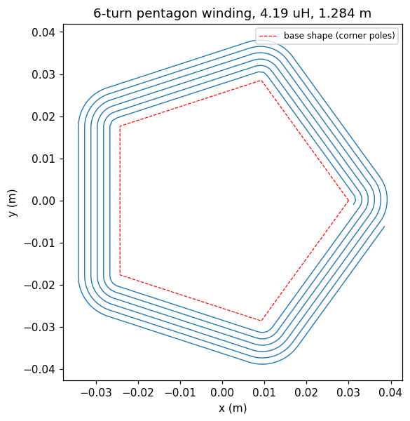

# Parameterised pentagon spiral winding

This example builds a planar spiral winding whose turns follow a rounded pentagon rather
than a circle, and calculates its self-inductance and total wire length with the
`ivsolver` binary.

The base shape is given directly as five vertex coordinates on the x-y plane, and those
vertices act as the centre poles for the cornering arcs. The winding is parameterised by

- `vertices` -- the five vertices, in order round the shape,
- `r_cs` -- wire cross-section radius,
- `pitch` -- radial advance per turn,
- `n_turns` -- number of turns,
- `r_corner_0` -- corner arc radius of the innermost turn.

Nothing in the construction assumes the pentagon is regular: any convex polygon in vertex
order will do, so the shape can be made irregular just by editing the coordinates. The
vertices may be listed clockwise or counter-clockwise.

The wire walks outwards turn by turn, alternating the `a` and `l` directives: an arc about
a corner pole, then a straight run along the offset edge to the next pole. The per-turn
advance is shared between the corners in proportion to the exterior angle each one turns,
so the radius grows uniformly with turned angle whatever the shape; since those angles sum
to `2*pi`, one lap advances exactly one `pitch`. For a regular pentagon this reduces to
`pitch / 5` per corner.

This is the use case the `a` directive exists for. The `s` directive can only spiral about
the origin, so a winding with five separate corner poles would otherwise need the whole
pattern translated between corners.

The notebook cross-checks the solver's reported length against a closed-form expression
for the same geometry; the two agree to within the discretisation error of approximating
the arcs by chords of one wire diameter (about 0.01% for the default parameters).

## Usage

Build the solver first (`make` in the repository root), then run `pentagon.ipynb`.
