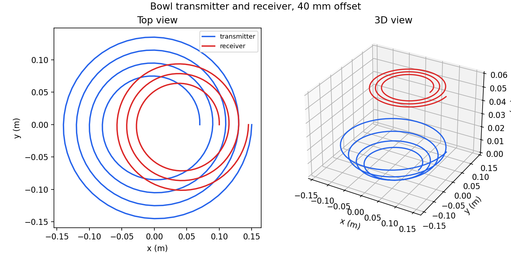
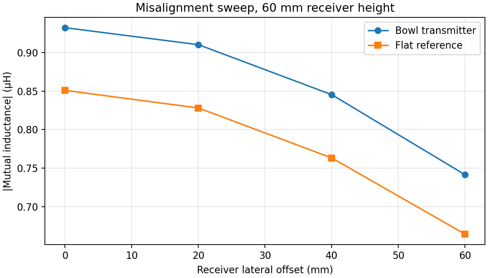

# Bowl-shaped transmitter under lateral misalignment

This study compares a 3D bowl transmitter with an otherwise identical flat transmitter. A three-turn flat receiver sits 60 mm above the transmitter centre. It is moved sideways by 0, 20, 40, and 60 mm. The bowl's four-turn path rises from `z = 0` at its 70 mm inner radius to `z = 20 mm` at its 150 mm outer radius, following `z = 3.125(r - 0.07)^2` in metres. Both windings use 1 mm wire radius. The reference transmitter keeps the same XY path at `z = 0`.



The displayed [wire definition](wire_def) is the 40 mm offset bowl case; its [solver matrix](result.lmat), in µH, is:

```text
5.04960  0.845284
0.845284 2.43590
```

The corresponding winding lengths are 2.76463 m for the bowl and 1.55536 m for the receiver. The script [generate_pairs.py](../generate_pairs.py) samples the 3D path into `l` points and evaluates both transmitter shapes at each offset. Its results are stored in [misalignment.csv](misalignment.csv).



| Receiver offset | Bowl mutual inductance | Flat mutual inductance | Bowl retains aligned value | Flat retains aligned value |
|---:|---:|---:|---:|---:|
| 0 mm | 0.932 µH | 0.851 µH | 100% | 100% |
| 20 mm | 0.910 µH | 0.828 µH | 97.6% | 97.3% |
| 40 mm | 0.845 µH | 0.763 µH | 90.7% | 89.7% |
| 60 mm | 0.741 µH | 0.664 µH | 79.5% | 78.1% |

In this limited sweep, the bowl gives higher absolute mutual inductance at every sampled offset and slightly better relative retention at 60 mm. It has also moved part of the transmitter physically closer to the receiver, so this is not a matched-gap shape comparison or proof that the bowl minimizes misalignment sensitivity. A fair optimization would constrain minimum clearance, conductor length, envelope, receiver tilt, and losses, then search the bowl depth and winding pitch over the required placement range.

Reproduce the sweep with `python3 examples/wireless_power/generate_pairs.py` after `make`.
