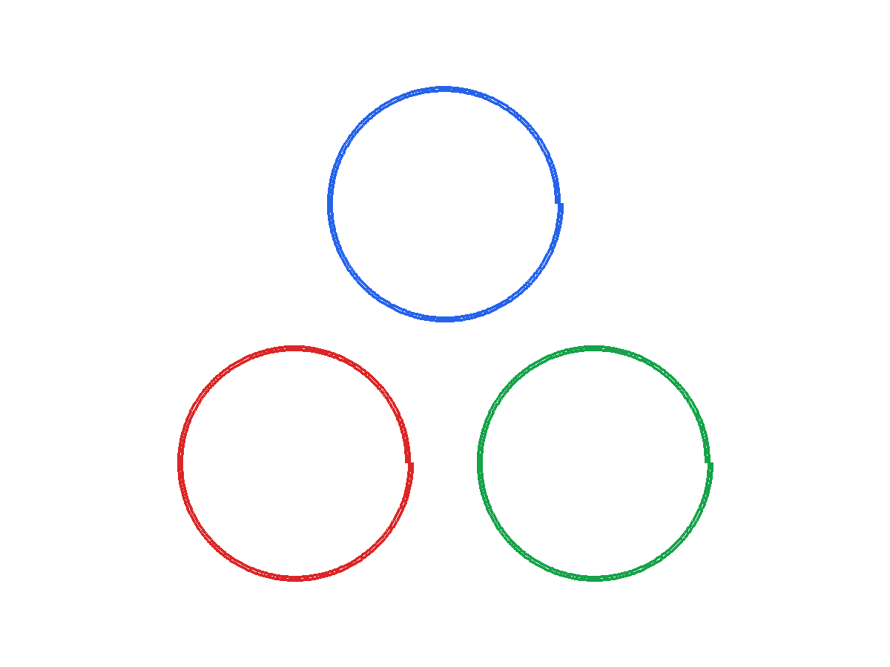

# Compact, low-inductance three-coil pad

## Design intent

Explore a three-channel transmitter pad where available area is limited. The requested maximum footprint radius is 380 mm. Two outward-growing turns per winding and 0.75 mm wire radius give a compact baseline. The design goal is 2.5 µH self-inductance per winding, within 0.5 µH, while keeping every mutual term among the three windings within 50 nH of zero.



## Ask the agent

> Design three identical, coplanar spiral windings at 120 degrees for a compact wireless power transmitter pad. Use two turns, copper resistivity 1.68×10⁻⁸ Ω·m, and 0.75 mm wire radius. Target 2.5 µH per coil within 0.5 µH and at most 50 nH absolute coupling between pad coils. Search inner radii 70–110 mm, pitch 3–5 mm, and lobe-centre radii 170–250 mm. Limit the footprint radius to 380 mm. Show the rendering, inductance matrix, DC resistance, and construction dimensions.

Equivalent `design_coil` arguments:

```json
{
  "target_self_inductance_uH": 2.5,
  "wire_radius_mm": 0.75,
  "resistivity_ohm_m": 1.68e-8,
  "inner_radius_min_mm": 70,
  "inner_radius_max_mm": 110,
  "turn_pitch_min_mm": 3,
  "turn_pitch_max_mm": 5,
  "lobe_center_radius_min_mm": 170,
  "lobe_center_radius_max_mm": 250,
  "inductance_tolerance_uH": 0.5,
  "mutual_tolerance_nH": 50,
  "turns": 2,
  "samples_per_axis": 3,
  "refine_rounds": 0,
  "max_footprint_radius_mm": 380
}
```

## Solver result

The bounded search evaluated 27 candidates and returned `feasible: true`.

| Quantity | Value |
|---|---:|
| Inner radius; radial pitch; outer radius | 110; 3; 116 mm |
| Distance from pad centre to each coil centre | 170 mm |
| Overall winding diameter, approximately | 572 mm |
| Self-inductance per coil | 2.57327 µH |
| Largest absolute mutual inductance | 40.0453 nH |
| Wire length per coil | 1.420 m |
| DC resistance per coil | 13.50 mΩ |
| Self-inductance / DC resistance | 0.191 ms |

Inductance matrix in µH, coil order matching the generated `wire_def`:

```text
 2.573270  -0.038565  -0.040045
-0.038565   2.573270  -0.039333
-0.040045  -0.039333   2.573270
```

Each winding grows outward in the XY plane. The three centre positions are equally spaced around a 170 mm radius. The target and mutual tolerances are met, but the selected 110 mm inner radius is at the search boundary; expanding that bound may find a better L/R result. The approximate diameter comes from twice the sum of lobe-centre and outer winding radii; conductor thickness adds a small amount.

Download the [SVG rendering](winding.svg), [solver wire definition](wire_def), or [full result](result.json). This example models mutual coupling among the pad's three windings only; a receiver and its operating gap must be added to estimate transferred power.
