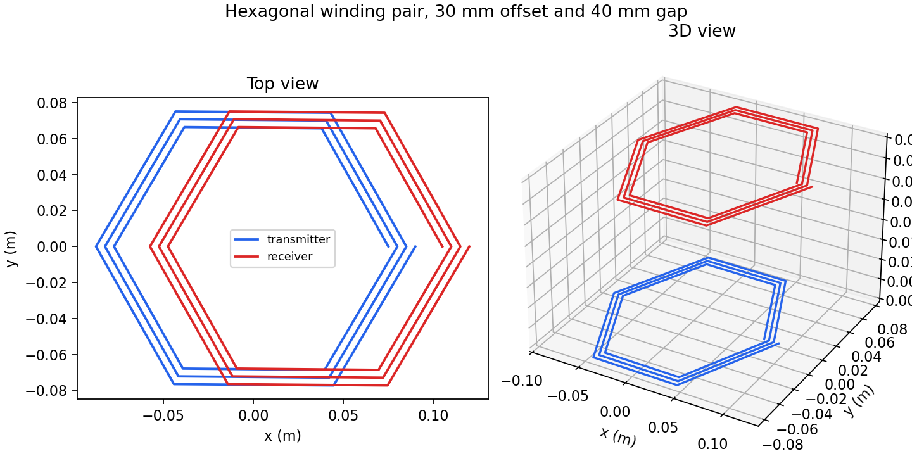

# Facing hexagonal winding pair

This study uses two three-turn hexagonal spirals. The transmitter is at `z = 0`; the receiver is 40 mm above it and shifted 30 mm in `x`. Both windings have 1 mm wire radius. Their hexagon circumradius grows from 75 to 90 mm as the turns progress.



The generator builds each six-sided spiral as a chain of straight `l` segments. This makes the corners and turn growth explicit in the [wire definition](wire_def). Run the case with:

```bash
make
build/ivsolver examples/wireless_power/hexagon_pair/wire_def examples/wireless_power/hexagon_pair/result
```

The [solver output](result.lmat) gives this inductance matrix in µH:

```text
2.87739  0.592125
0.592125 2.87739
```

Each path is 1.48506 m long. The coupling coefficient from this matrix is approximately `0.206` at the illustrated offset and gap. The off-diagonal term represents cross-gap transmitter/receiver coupling. To explore angular orientation or lateral misalignment, change the receiver's position or rotation in [generate_pairs.py](../generate_pairs.py), regenerate the wire definition, and compare the new mutual term. The example does not establish that a hexagon outperforms a circle; that needs a matched-area or matched-copper comparison.
